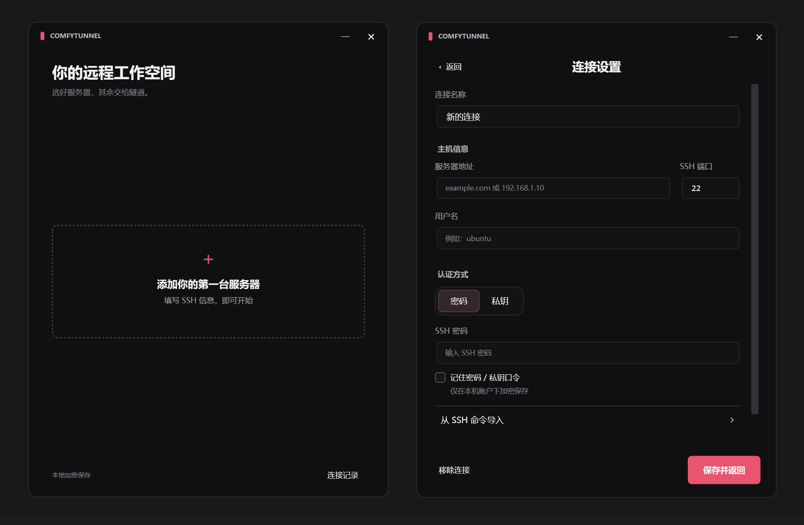

# ComfyTunnel

Windows 桌面 SSH 隧道工具，让本机浏览器、ComfyUI Desktop 或 API 客户端访问 GPU 服务器上的 ComfyUI。

支持多台服务器配置、密码或私钥认证、托盘运行和断线自动重连。自包含单 EXE，无需另外安装 .NET、SSH 客户端或 WSL。



## 快速开始

从 [Releases 下载 ComfyTunnel.exe](https://github.com/AKeyR4y/ComfyTunnel/releases/latest)，直接运行即可，无需安装。也可按下方步骤从源码构建。

1. 点击「添加你的第一台服务器」，填写 SSH 地址、端口、用户名和认证信息，也可从 SSH 命令导入。
2. 保存配置，按需开启首页的 ComfyUI 开关，然后点击「连接」。首次连接需核对并确认服务器指纹。
3. 连接成功后，点击「复制地址」供客户端使用，或点击「打开 ComfyUI」手动打开浏览器。

ComfyUI 转发默认关闭，关闭时只建立 SSH 会话。开关按服务器分别保存，修改前需先断开；它不会启动或停止远端 ComfyUI。

| 设置 | 默认值 |
| --- | --- |
| SSH 端口 | `22` |
| 远端 ComfyUI 地址 | `127.0.0.1:8188` |
| 本地访问地址 | `http://127.0.0.1:18188/` |

自动端口模式下，本地端口被占用时会选择可用端口，请以界面显示的实际地址为准；自动重连保持原地址。目标地址从 SSH 服务器所在网络访问，可在设置中修改。

切换服务器会停止旧连接，需手动连接新服务器。连接及重连过程中均可取消，连接成功后不会自动打开浏览器。关闭窗口后程序留在托盘，右键托盘选择「退出」才会结束连接和程序。

## 使用说明

- 远端需已运行 ComfyUI，SSH 服务器需允许端口转发；无需将 ComfyUI 端口暴露到公网。
- 同一时间运行一条连接，本地转发仅监听 `127.0.0.1`。
- 支持导入 SSH 命令的 `-p`、`-l`、`-i` 参数；命令仅作文本解析，不执行 shell 或远端命令。
- 断线恢复后，浏览器或客户端可能需要重新连接；程序不会重新提交生成任务。
- 电脑睡眠期间连接会中断；仅 SSH 模式下，静默断网的检测可能需要等待系统 TCP 超时。
- 在 WSL 或 Docker 内使用客户端时，其 `localhost` 不一定指向 Windows，需另行配置。

当前版本为 **0.6.0**，面向 Windows 10/11 x64，已在当前 Windows 11 环境验证启动。独立 Windows 10、真实 GPU ComfyUI 和 24 小时持续运行尚未验证，详见 [验证报告](docs/verification.md)。程序未进行代码签名。

## 配置与安全

连接配置和服务器指纹保存在 `%LOCALAPPDATA%\ComfyTunnel`，使用 Windows DPAPI 加密，绑定当前 Windows 用户与机器。密码与私钥口令仅在选择「记住」时保存，私钥文件默认只保存路径。日志按大小轮转，不记录密码、私钥或完整原始命令。

首次连接需确认服务器的 SHA-256 指纹；指纹变化会阻止连接，请核实服务器身份。加密配置不能直接作为跨机器备份使用。

## 构建与测试

使用 C#、WPF 和 SSH.NET。开发环境需要 .NET SDK `10.0.403`（见 `global.json`），SSH.NET 固定为 `2026.0.0`，依赖锁文件随源码提供。脚本优先使用 `.tools/dotnet/dotnet.exe`，否则使用 PATH 中的 `dotnet`。

```powershell
./scripts/build.ps1
./scripts/test.ps1
./scripts/build.ps1 -Publish
```

单文件输出为 `dist/win-x64/ComfyTunnel.exe`。发布前请退出该程序。第三方许可已嵌入 EXE，可在「连接记录 → 第三方许可」查看。

真实 SSH 集成测试另需 Node.js 和 npm：

```powershell
Push-Location tests/fixture
npm ci --ignore-scripts
Pop-Location
./scripts/test.ps1 -Integration
```

测试服务仅监听本机回环地址，使用端口 `22222`、`18189`、`18190`，并测试转发端口 `18188`；运行前请确保端口空闲。测试使用本机构造的凭据，数据写入被 Git 忽略的 `test-results/`。

## 相关文档

- [更新记录](CHANGELOG.md)
- [验证报告](docs/verification.md)
- [第三方声明](THIRD-PARTY-NOTICES.md)
